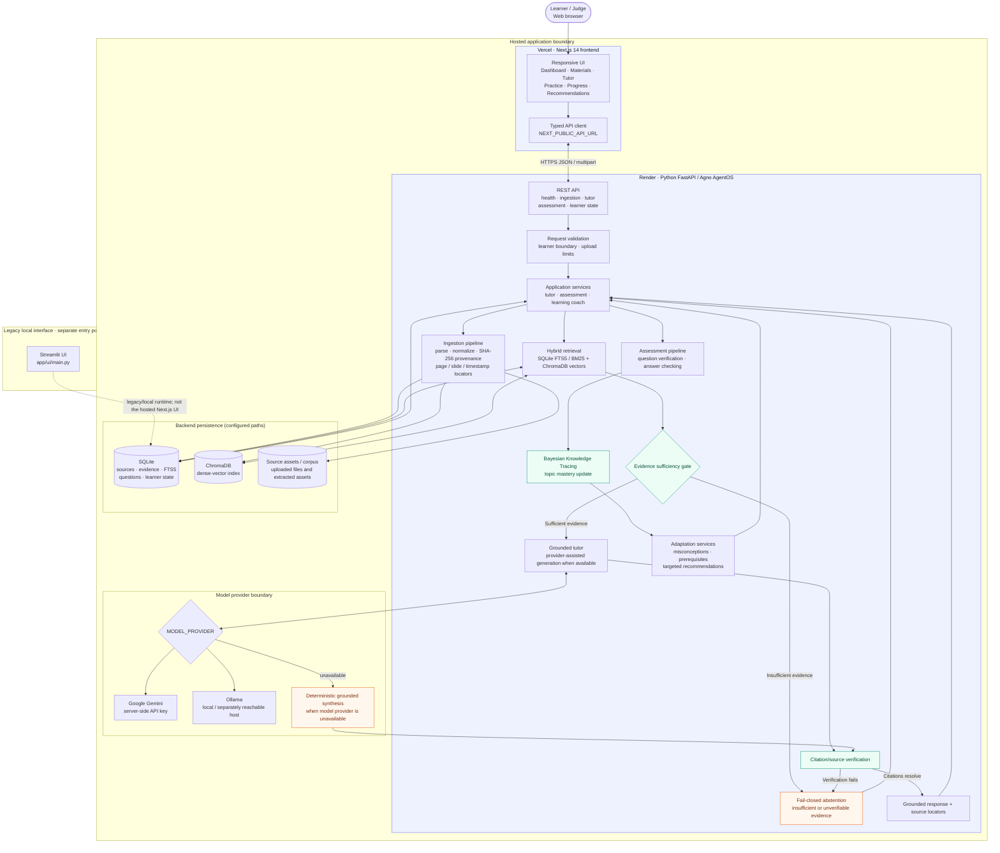

# CogniVault — Technical Architecture

**Product:** Evidence-First Adaptive Learning  
**Hackathon track:** Track D — Personalized Tutoring & Adaptive Learning  
**Runtime:** Next.js 14 frontend · FastAPI/Agno AgentOS backend · SQLite/FTS5 · ChromaDB · configurable model provider

## 1. System architecture

The diagram distinguishes the hosted request path, backend application services, retrieval/grounding controls, learner-state updates, and the preserved legacy Streamlit interface. Arrows indicate the primary data/control flow.

### Request paths at a glance

1. **Material ingestion:** Browser → Next.js API client → FastAPI upload endpoint → parse and normalize content → record SHA-256/source locators → persist evidence → update lexical and semantic indexes.
2. **Grounded tutoring:** Query → hybrid retrieval → evidence sufficiency gate → model-assisted or deterministic synthesis → citation/source verification → grounded answer, or explicit abstention.
3. **Adaptive practice:** Assessment selection/generation → deterministic question verification → learner answer checking → BKT mastery update → misconception/prerequisite analysis → targeted recommendations.
4. **Persistence:** SQLite stores structured source/evidence records, FTS5 index, assessments, interactions, and learner state; ChromaDB stores/query dense vectors; source files/assets use configured filesystem paths.
5. **Provider selection:** Backend configuration selects Gemini or Ollama. Secrets belong in backend environment variables only. If no provider is available, behavior must remain explicit and must not fabricate a successful model response.

## 2. Component responsibilities

| Component | Responsibility | Main implementation |
|---|---|---|
| Web client | User journeys, upload forms, tutoring, practice, progress views, citation drawer | `frontend/` |
| API boundary | Typed HTTP contracts, health checks, upload handling, learner-ID validation | `app/agent_os/app.py` |
| Application orchestration | Coordinates tutor, assessment, and learning-coach services | `app/agent_os/service.py` |
| Ingestion/provenance | Extracts supported content, records source identity and physical locators | `app/ingest.py`, `app/db.py` |
| Retrieval | Lexical search, dense search, deterministic hybrid score fusion and trace | `app/retrieval.py`, `app/chroma_store.py` |
| Grounding boundary | Evidence sufficiency, citation resolution, explicit abstention | `app/sufficiency.py`, `app/source_resolver.py`, `app/agent_os/tutor_agent.py` |
| Assessment | Question selection/generation, answer-key validation, answer evaluation | `app/assessment.py` |
| Learner model | Per-topic mastery state and Bayesian Knowledge Tracing updates | `app/learner_model.py` |
| Adaptation | Misconception signals, prerequisite-aware and targeted recommendations | `app/misconceptions.py`, `app/recommendation.py` |
| Persistence | Structured records, FTS5, learner history, vectors and source assets | `app/db.py`, `app/chroma_store.py` |
| Legacy UI | Preserved Streamlit entry point for local/legacy workflows | `app/ui/main.py` |

## 3. Retrieval and evidence policy

- **Lexical channel:** SQLite FTS5 search; lexical relevance is normalized for fusion.
- **Semantic channel:** ChromaDB dense-vector similarity when embeddings are available.
- **Hybrid score:** `0.45 × lexical score + 0.55 × semantic score`; ties are deterministically ordered by evidence ID.
- **Evidence gate:** Requires the configured relevance and essential-term-coverage thresholds before generation.
- **Citation verification:** Citations must resolve to stored evidence and a physical source locator. Missing or invalid evidence must not be presented as verified.
- **Abstention:** Empty retrieval, insufficient evidence, provider failure, or citation verification failure must produce a clear, non-deceptive response rather than invented support.

## 4. Learner adaptation

- **BKT:** Each response updates the learner's topic mastery using the configured initial mastery, guess, slip, and transition parameters.
- **Assessment integrity:** Candidate questions are checked by deterministic verification before being served; repeated questions are suppressed according to the configured policy.
- **Misconception diagnostics:** Repeated error patterns can trigger a misconception signal and targeted remediation.
- **Prerequisites:** Recommendations and topic progression use the configured mastery thresholds and prerequisite relationships.
- **Learner boundaries:** Learner identifiers are validated; where the API receives a learner identity header, it must agree with the requested learner path.

## 5. Deployment and operational boundaries

- **Frontend:** Vercel-hosted Next.js application; the public API base URL is configured with `NEXT_PUBLIC_API_URL`.
- **Backend:** Render-hosted FastAPI/Agno AgentOS; bind to the platform-provided `PORT` and configure CORS for the actual frontend origin.
- **Model secrets:** `GEMINI_API_KEY` is server-side only. Never expose provider credentials through `NEXT_PUBLIC_*` variables, committed files, logs, or client bundles.
- **Local mode:** Ollama is reachable only from the machine/network where it runs; `localhost` inside a cloud container refers to that container, not a developer laptop.
- **Storage caveat:** SQLite and ChromaDB paths are filesystem-backed unless explicitly configured otherwise. A free container's local filesystem may be ephemeral; do not promise durable learner uploads or cross-restart persistence without verifying the hosting storage configuration.
- **Legacy Streamlit:** `app/ui/main.py` is a separate preserved entry point, not the browser UI served by the Vercel deployment.

## 6. Failure boundaries

| Failure | Required behavior |
|---|---|
| No indexed evidence | Explain that no supporting course evidence is available |
| Evidence below sufficiency threshold | Abstain with a clear reason |
| Citation cannot be resolved | Reject/suppress the unsupported claim |
| Model provider unavailable | Surface provider status or use the documented deterministic path; never pretend a live model call succeeded |
| Invalid learner identity / boundary mismatch | Reject the request |
| Upload too large or malformed | Return a controlled validation error |
| Persistence/indexing failure | Return an actionable error and log safe diagnostic details without secrets |

## 7. Architecture scope

This is a modular application with one HTTP backend and a separate web frontend—not a microservices or Kubernetes deployment. The retrieval, grounding, assessment, learner-model, and recommendation responsibilities are separated at the application-module level so they can be tested independently while sharing a consistent evidence and learner-state store.
