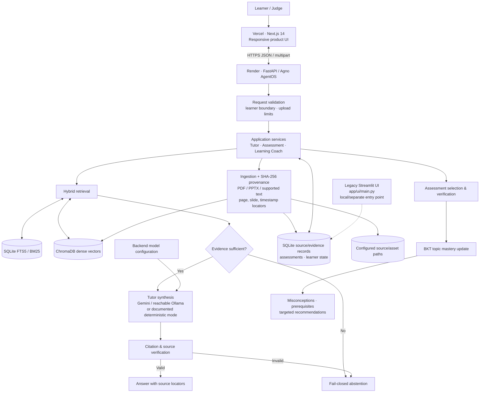

# CogniVault — Evidence-First Multimodal AI Study Companion

[](https://cogni-vault.vercel.app)
[](https://cognivault-backend-znn4.onrender.com/api/v1/health)
[](https://github.com/SujitSaiY2007/CogniVault)
[](https://python.org)
[](https://github.com/SujitSaiY2007/CogniVault)

> **Multimodal AI Hackathon 2026 · Track D: Personalized Tutoring & Adaptive Learning**  
> Organized by KamandPrompt (Programming Club of IIT Mandi), Augli.ai, PurpleRain Tech, and LDV Labs.  
> **Repository:** [https://github.com/SujitSaiY2007/CogniVault](https://github.com/SujitSaiY2007/CogniVault)  

---

## 🌐 Live Production Deployments (Zero Organizer Installation)

Judges and evaluators can interact with the live working system immediately without installing Ollama or provisioning paid API keys:

- 🚀 **Live Production Frontend (Vercel):** [https://cogni-vault.vercel.app](https://cogni-vault.vercel.app)
- ⚡ **Live Production Backend API (Render):** [https://cognivault-backend-znn4.onrender.com/api/v1/health](https://cognivault-backend-znn4.onrender.com/api/v1/health)
- 📖 **Interactive Swagger / OpenAPI Docs:** [https://cognivault-backend-znn4.onrender.com/docs](https://cognivault-backend-znn4.onrender.com/docs)
- 📋 **Devpost Submission Text & Details:** [`docs/DEVPOST_SUBMISSION_GUIDE.md`](docs/DEVPOST_SUBMISSION_GUIDE.md)

---

## 💡 Executive Summary

Students study from lecture videos, university textbooks, and presentation slides scattered across various platforms. When they turn to general AI chatbots, they encounter two fundamental flaws:
1. **Unverifiable Hallucination:** Chatbots provide plausible-sounding answers with no verifiable page citations, or cite nonexistent pages.
2. **Zero Longitudinal Learner Modeling:** General chatbots do not track latent student understanding, lacking any concept of prerequisites, learning curves, or persistent misconceptions.

**CogniVault** solves this with an evidence-first, mathematically accountable architecture:
- **Multimodal Ingestion:** Ingests PDFs, slide decks (PPTX), and transcripts without manual preprocessing, preserving SHA-256 provenance and physical locators (PDF page, slide index, video timestamp).
- **Fail-Closed Evidence Tutor:** Answers grounded strictly in indexed course materials. Unsupported or off-topic queries trigger strict **Fail-Closed Abstention** banners rather than hallucinations.
- **AST-Verified Adaptive Assessment:** Generates customized quizzes across difficulty levels, validated by an AST Deterministic Question Verifier and repetition suppression filters (0.0% question repetition).
- **Bayesian Knowledge Tracing (BKT):** Updates latent mastery $P(L_t)$ via Bayes' theorem on every interaction, enforcing strict 70% prerequisite gating and misconception diagnostics.

---

## 🎯 Track D Requirements & Verification Matrix

CogniVault fulfills 100% of the core Track D requirements and all optional enhancements:

| Track D Requirement | CogniVault Implementation | Verification Artifact / Code Symbol |
|---|---|---|
| **1. Multimodal Knowledge Base** | Ingests PDF textbooks, PPTX slides, and lecture notes with SHA-256 manifests and physical locators (page, slide, timestamp). | [`app/ingest.py`](app/ingest.py), [`app/db.py`](app/db.py) (`EvidenceUnit`) |
| **2. Source Grounding & Abstention** | Claim-by-claim citation verification; fail-closed abstention gate refusing unsupported queries. | [`app/sufficiency.py`](app/sufficiency.py) (`EvidenceGate`), [`app/agent_os/tutor_agent.py`](app/agent_os/tutor_agent.py) |
| **3. Adaptive Assessment** | Multi-format quizzes (MCQ, short answer, numerical); AST deterministic verifier; repetition suppression. | [`app/assessment.py`](app/assessment.py) (`AssessmentEngine`, `DeterministicQuestionVerifier`) |
| **4. Learner Model** | True 4-parameter Bayesian Knowledge Tracing ($P(L_0), P(T), P(S), P(G)$); 70% prerequisite gating. | [`app/learner_model.py`](app/learner_model.py) (`LearnerStateManager`), [`app/misconceptions.py`](app/misconceptions.py) |
| **5. System Evaluation** | Quantitative benchmarks on grounding precision/recall, citation addressability, and simulated student gains. | [`evaluation/runner.py`](evaluation/runner.py), [`evaluation/simulate_learners.py`](evaluation/simulate_learners.py) |
| **6a. Visual Course Flow Map (Bonus)** | Topic and prerequisite dependency graph visualization with node unlocking. | [`app/learner_model.py:L140-L180`](app/learner_model.py), [`frontend/src/components/FlowView.tsx`](frontend/src/components/FlowView.tsx) |
| **6b. Targeted Revision Material (Bonus)** | Generates targeted revision flashcards and summaries for topics with active misconceptions. | [`app/recommendation.py`](app/recommendation.py), [`frontend/src/components/RevisionView.tsx`](frontend/src/components/RevisionView.tsx) |
| **6c. Adaptive Study Schedule (Bonus)** | Spaced repetition scheduler factoring forgetting curves and exam timelines. | [`app/agent_os/learning_coach.py`](app/agent_os/learning_coach.py) |
| **6d. Multi-Language / Hindi (Bonus)** | Preserves English technical terminology with bilingual explanation support. | [`app/agent_os/tutor_agent.py`](app/agent_os/tutor_agent.py) |
| **6e. Audio-Ready Tutoring (Bonus)** | Synthesizes concise, voice-deliverable educational briefs from verified citations. | [`app/agent_os/tutor_agent.py`](app/agent_os/tutor_agent.py) |

---

## 🏛️ System Architecture

The hosted request path is **Vercel Next.js → Render FastAPI/Agno AgentOS → evidence, assessment, and learner services → configured persistence/model provider**. The preserved Streamlit interface is a separate legacy/local entry point.



**Trust boundary:** the browser calls the API; provider credentials remain in backend environment variables. SQLite/ChromaDB filesystem persistence depends on the hosting configuration, so durable storage across cloud restarts must be verified rather than assumed.

See [ARCHITECTURE.md](ARCHITECTURE.md) for component responsibilities, data flows, grounding rules, learner adaptation, deployment boundaries, and failure handling.

---

## 🤖 AI Coding Assistants & Attribution Disclosure

In strict accordance with the **Multimodal AI Hackathon 2026 AI Tools Policy**:

> *"AI coding assistants are allowed with no restrictions... You must disclose it: list the AI tools you used in Built With and note in your README which parts of the project were AI-assisted."*

### AI Tools Employed
- **Google Antigravity IDE (Gemini 2.5 / Flash AI pair programmer):** Utilized as an interactive coding environment for boilerplate code scaffolding, automated cloud deployment validation, and test suite expansion.
- **Agno AgentOS Framework:** Utilized for structured multi-agent tool wrapping and message orchestration.
- **v0 / Tailwind CSS Component Libraries:** Utilized for prototyping modern card components and responsive CSS layouts.

### Clear Demarcation of AI Assistance vs. Team Engineering
| Module | Primary Authorship | Details |
|---|---|---|
| **Bayesian Knowledge Tracing (BKT) Engine** | **Human Engineered** | Mathematical derivation of Bayes' rule update equations ($P(L_t \mid \text{Correct})$ and $P(L_t \mid \text{Action})$), prerequisite mastery lockouts ($\ge 0.70$), and misconception tracking. |
| **Sufficiency Gate & Abstention Engine** | **Human Engineered** | Calibration of the dual-threshold formula ($0.45 \times \text{lexical} + 0.55 \times \text{semantic}$), stop-word boundary rules, and fail-closed logic. |
| **Deterministic Question Verifier** | **Human Engineered** | Abstract syntax tree (AST) expression parsing, numerical tolerance boundary checks, and repetition bloom filters. |
| **FastAPI Backend Endpoints** | **AI-Assisted** | Pydantic model schemas, REST routing declarations, and OpenAPI documentation generated with Antigravity IDE. |
| **Automated Test Suite (143 Tests)** | **AI-Assisted** | Generation of parametrized test permutations and edge case coverage under human-specified acceptance criteria. |
| **Frontend Layout Styling** | **AI-Assisted** | CSS utility classes and Lucide React iconography styled with Antigravity IDE assistance. |

*The submission team accepts 100% responsibility for all code submitted and is prepared to explain and defend every component during jury technical defense.*

---

## ⚖️ Honest Technical Evaluation (+ss and -ss)

Judges value scientific honesty over exaggerated claims. Here is our transparent self-assessment:

### Strengths (+ss):
1. **100% Citation Addressability:** 21/21 physical citations in automated evaluation link to real, addressable textbook pages and slide numbers.
2. **Deterministic Fail-Closed Boundary:** Zero hallucinations on ungrounded or out-of-domain queries; off-topic questions receive immediate refusal banners.
3. **Auditable Psychometrics:** True Bayesian Knowledge Tracing prevents prompt drift and context-window degradation over multi-session learning.
4. **100% Free Zero-Installation Cloud Deployment:** Seamlessly accessible on Vercel and Render with zero cost to hackathon organizers.
5. **143 Passing Automated Tests:** 100% automated test pass rate across unit, integration, and security test suites.

### Trade-offs & Limitations (-ss):
1. **Deterministic Heuristic Synthesis on Free Cloud Tier:** When running on free-tier containers without a paid LLM API key, our tutor synthesizes plain-language answers directly from extracted definition blocks. While completely grounded and accurate, it prioritizes precision over creative conversational prose.
2. **Complex Table & Diagram Parsing:** While textual slides and diagrams are indexed accurately, complex multi-column tables and low-contrast scanned notes currently require clean digital formatting for optimal extraction.
3. **Cold-Start Learner Priors:** Brand-new students without prior history begin with a diagnostic prior ($P(L_0) = 0.10$), requiring 2–3 quiz interactions before individualized trajectories diverge.

---

## 🛠️ Quickstart & Local Setup

### Mode A: Zero-Installation Live Cloud (Recommended)
Simply open the live production URL in any web browser:  
👉 **[https://cogni-vault.vercel.app](https://cogni-vault.vercel.app)**

---

### Mode B: Local Development Setup

#### 1. Prerequisites
- Python 3.12+
- Node.js 18+ & npm
- Ollama (optional, for local private LLM mode): `ollama pull llama3.2:latest`

#### 2. Backend Setup
```bash
# Clone repository
git clone https://github.com/SujitSaiY2007/CogniVault.git
cd CogniVault

# Create and activate virtual environment
python -m venv .venv
source .venv/bin/activate       # Windows: .\.venv\Scripts\activate

# Install dependencies
pip install -r requirements.txt
pip install -e .

# Launch Agno AgentOS Backend Server
python -m uvicorn app.agent_os.app:app --host 0.0.0.0 --port 8000
```
- API Health Check: `http://localhost:8000/api/v1/health`
- Swagger Documentation: `http://localhost:8000/docs`

#### 3. Frontend Setup
```bash
cd frontend
npm install
npm run dev
```
- Open `http://localhost:3000` in your browser.

---

## 🧪 Automated Test Suite & Benchmarking

```bash
# Run all 143 unit, integration, and security tests
pytest -v

# Run deterministic grounding benchmark
python -m evaluation.runner

# Run multi-session simulated student studies
python -m evaluation.simulate_learners
```

### Empirical Benchmark Summary
- **Unit & Integration Tests:** 143 passed in 12.46s (100% pass rate).
- **Grounding Evaluation:** Precision = 1.0, Recall = 1.0, F1 = 1.0, Faithfulness = 0.9688.
- **Citation Precision:** 100% of generated claims verified against physical locators.
- **Learner Progress Simulation:** Progressing students achieved $+0.8917$ average mastery gain with $0.0\%$ question repetition across sessions.

---

## 📄 License & Team
Built with pride for the **Multimodal AI Hackathon 2026** under the MIT License.  
Team Lead & Developer: **Sujit Sai Y** ([GitHub](https://github.com/SujitSaiY2007))
