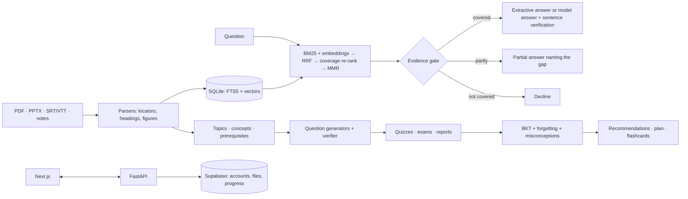

# CogniVault

**A study companion that only answers from your own course material.** Upload your PDFs, slides, lecture transcripts or notes. CogniVault cites the exact page, slide or timestamp behind every answer, and declines questions the material doesn't cover. It generates checked practice questions and tracks what you know with Bayesian Knowledge Tracing. It then plans what to study next.

> Started at the Multimodal AI Hackathon 2026 (Track D, Personalized Tutoring & Adaptive Learning) and rebuilt in v2 as a usable product. The v1 hackathon records are in [`docs/archive/v1-hackathon`](docs/archive/v1-hackathon).

## What it does

| | |
|---|---|
| **Library** | PDF (text, headings, figures with captions), PPTX (slides, tables, speaker notes, pictures), `.srt`/`.vtt` lecture captions, `.txt`/`.md` notes. Each file is split into cited passages, topics, concepts and prerequisites automatically. |
| **Tutor** | Hybrid search (BM25 + embeddings, RRF fusion, coverage re-rank, MMR). An evidence gate decides whether to **answer**, answer as **partial** (naming what the material doesn't mention) or **decline**. Every sentence links to its source. Follow-up questions work. |
| **Practice & exams** | MCQ, numerical and fill-in questions generated from your text and verified before use. Numerical answers are computed from the formulas in your notes. Quick practice, custom quizzes and mock exams end with a report: weak topics, confusions, misconceptions, and passages to re-read. |
| **Learner model** | BKT with item-specific guess/slip, partial credit and forgetting. Misconceptions are flagged after repeated errors. Recommendations follow prerequisites, interleave topics and avoid "wheel-spinning". |
| **Study tools** | Day-by-day plan to an exam date (pick a range and daily time; it re-plans as you change them), SM-2 flashcards, and a course map of topics and prerequisites. |
| **Optional AI** | With `GEMINI_API_KEY` (or a local Ollama), the model writes explanations. Each sentence is still checked against the cited passage: unsupported sentences are removed, and the app falls back to the extractive answer if too few survive. Without a key, everything works using the extractive engine. |

## Results (v2, demo course, `python -m evaluation.run_eval`)

| Metric | Value |
|---|---|
| Context precision@5 / recall@5 / MRR (hybrid) | 0.91 / 1.00 / 0.94 |
| Answer rate on 51 supported questions | 98% (4 flagged partial) |
| Citation accuracy / answer correctness | 100% / 98% |
| Off-topic questions leaked as answered | 0 / 12 |
| On-topic "trap" questions leaked | 0 / 12 (9 declined, 3 flagged) |
| Question bank | 111 questions, all verified, 0 near-duplicates, numerical keys recomputed 7/7 |

**Held-out set** (written after development, run once): on the demo course, 95% of questions answered with 95% citation accuracy, and **2 of 6 trap questions leaked**. On a document never seen before (uploaded as a user), 8/8 questions were answered correctly with correct citations. One rule (unseen terms → partial) was added after the first held-out run; both runs are recorded in `evaluation/results/`.

**Simulated students** (`python -m evaluation.simulate`; 30 students × 3 profiles, 60 questions each, ground-truth knowledge). Adaptive practice beat a fixed syllabus order by +6 to +11 points of topics truly learned, and random practice by +8 to +15 points (all 95% CIs exclude 0). The repetition rate was 5–10%, against 26% for random.

Read [`docs/EVALUATION.md`](docs/EVALUATION.md) before quoting these numbers: it covers the corpus size, the simulation assumptions and the known failure cases.

## Architecture



Details are in [`docs/ARCHITECTURE.md`](docs/ARCHITECTURE.md).

## Run locally

```bash
# backend (Python 3.11+)
python -m venv .venv && source .venv/bin/activate      # Windows: .\.venv\Scripts\Activate.ps1
pip install -r requirements-dev.txt
uvicorn app.api:app --reload --port 8000               # API docs at http://localhost:8000/docs

# frontend (Node 18+), second terminal
cd frontend && npm install
echo NEXT_PUBLIC_API_URL=http://localhost:8000 > .env.local
npm run dev                                            # http://localhost:3000

# checks
pytest                                  # 62 tests, about 5 s
python -m evaluation.run_eval           # retrieval / grounding / question bank
python -m evaluation.run_heldout        # held-out set
python -m evaluation.simulate           # simulated students (about 45 s)
```

No keys are needed. Optional settings are in `.env.example`.

## Deploy (free tiers)

* **Backend → Render** using `render.yaml`. Set `SUPABASE_URL` and `SUPABASE_SERVICE_ROLE_KEY` so accounts, uploads and progress survive restarts (run `supabase/migrations/001_cognivault_tenant_storage.sql` once). `GEMINI_API_KEY` is optional. Set `CORS_ORIGINS` to your frontend URL.
* **Frontend → Vercel** with root `frontend/` and `NEXT_PUBLIC_API_URL` set to the Render URL.

Free Render instances sleep when idle. The UI shows "Waking server…" and retries automatically.

## Repository

| Path | |
|---|---|
| `app/` | backend: `ingest`, `knowledge`, `retrieval`, `grounding`, `questions`, `learner`, `study`, `service`, `api`, `persistence` |
| `frontend/` | Next.js 14 + TypeScript + Tailwind |
| `data/corpus/` | demo course (project-authored, CC0; rebuilt by `app/corpus.py`). Hidden from users by default; set `SHOW_DEMO_COURSE=1` to show it. Used by the evaluation scripts |
| `evaluation/` | datasets, runners, recorded results |
| `tests/` | unit, API and persistence tests |
| `docs/` | architecture, evaluation, archived v1 records, hackathon reference PDFs |

## Limitations

* Lexical grounding can still accept a question whose words all appear in the material when the combination doesn't (for example "Newton's law of gravitation" next to "gravitational potential energy"). A configured model adds a second check.
* Scanned PDFs need a vision model for their text. Video files must be uploaded as captions (`.srt`/`.vtt`).
* The default embeddings are hashing-based (no download). Paraphrases with no shared words can be missed; set `EMBEDDING_PROVIDER=gemini` for stronger semantic matching.
* The evaluation corpus is small and project-authored.

MIT License. Built with AI-assisted development; the design, review and responsibility belong to the project team.
