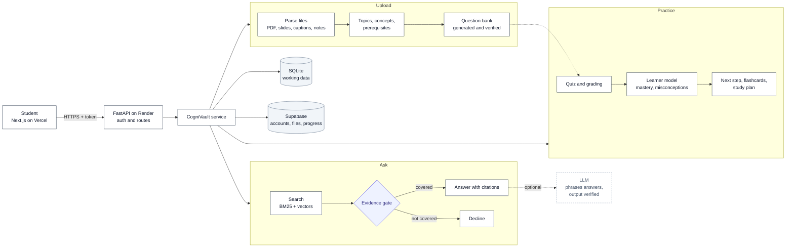

# CogniVault

**An evidence-first study companion that answers only from your own course material.**

## Description

Students often use general AI tools that sound confident but cannot show where an answer came from. CogniVault fixes this. You upload your own PDFs, slides, lecture captions or notes. The app then:

- **Answers with proof.** Each answer links to the exact page, slide or timestamp it came from. If your material does not cover a question, it says so instead of guessing.
- **Builds practice.** It creates checked quiz questions from your material and grades your answers.
- **Tracks what you know.** A learner model estimates your mastery of each topic and spots repeated mistakes.
- **Plans your study.** It suggests what to practise next, schedules flashcards, and builds a day-by-day plan up to your exam date.

Search, grounding checks, question generation and the learner model are rule-based and statistical. An optional language model only helps to phrase answers, and every sentence it writes is checked against your sources. The app works fully without a model.

## Tech Stack

| Layer | Technology | Used for |
| --- | --- | --- |
| Frontend | Next.js 14, React 18, TypeScript, Tailwind CSS | The web interface (`frontend/`) |
| Backend | Python 3.12, FastAPI, Pydantic, uvicorn | The API and all core logic (`app/`) |
| File parsing | PyMuPDF, python-pptx, Pillow | Reading PDFs, slides and images |
| Search | SQLite FTS5 (BM25), NumPy vectors, rank fusion | Finding the right passages |
| Learner model | Bayesian Knowledge Tracing, SM-2 | Mastery, recommendations, flashcards |
| Storage | SQLite while running, Supabase (Postgres and private file storage) for durability | Accounts, uploads and progress |
| Optional AI | Google Gemini or a local Ollama model | Phrasing answers and describing figures |
| Hosting | Vercel (frontend), Render (backend), Supabase (data) | Free-tier deployment |

## Architecture



**Reading it:** the browser talks to one backend service. Three flows run through it. *Upload* turns files into topics and questions. *Ask* searches your material and the evidence gate decides whether to answer or decline. *Practice* grades answers and updates the learner model, which drives recommendations. Data is kept in SQLite while running and in Supabase for the long term. The LLM is optional and only phrases answers.

## Deployment

**Live app:** https://cogni-vault.vercel.app

| Part | Where | How |
| --- | --- | --- |
| Frontend | Vercel | Root `frontend/`, branch `main`. Set `NEXT_PUBLIC_API_URL` to the Render URL. |
| Backend | Render | Uses `render.yaml`. Start command: `uvicorn app.api:app --host 0.0.0.0 --port $PORT`. |
| Database | Supabase | Run `supabase/migrations/001_cognivault_tenant_storage.sql` once. Set `SUPABASE_URL` and `SUPABASE_SERVICE_ROLE_KEY` on Render. |

Optional settings (`GEMINI_API_KEY`, `CORS_ORIGINS` and others) are listed in `.env.example`. Copy it to `.env` for local use. On Render, set the same names in the dashboard.

**Run locally** (no keys needed):

```bash
# backend (Python 3.11+)
pip install -r requirements-dev.txt
uvicorn app.api:app --reload --port 8000

# frontend (Node 18+), in a second terminal
cd frontend && npm install
echo NEXT_PUBLIC_API_URL=http://localhost:8000 > .env.local
npm run dev

# tests
pytest
```

## Use-Case

- **A student before exams.** Upload lecture slides and notes, ask doubts, and get answers with page or slide references. Take a mock exam, then follow the plan the app builds.
- **Self-study from a textbook.** Upload chapters, and the app splits them into topics and orders them by prerequisites.
- **Revision.** Flashcards and quizzes focus on weak topics, and the app brings back topics you are about to forget.
- **Catching misunderstandings.** After repeated errors on a concept, the app names the likely misconception and points to the passage to re-read.

## Limitations

- Keyword-based grounding can accept a question whose words all appear in the material when the combination does not. A configured language model adds a second check.
- Scanned PDFs need a vision model to read their text. Videos must be uploaded as captions (`.srt` or `.vtt`).
- The default embeddings are hash-based, so paraphrases that share no words can be missed. Set `EMBEDDING_PROVIDER=gemini` for better matching.
- The evaluation data is small and written by the project team. The learner model and recommendations were tested on simulated students, not real ones.
- The free Render server sleeps when idle, so the first request can take up to a minute.
- Without Supabase configured, accounts and uploads are lost when the backend restarts.

## License

Released under the [MIT License](LICENSE).
