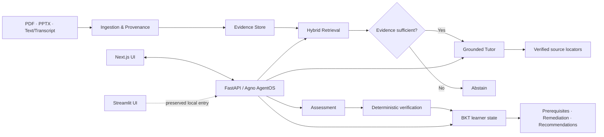

# CogniVault

**An evidence-first adaptive learning companion** that connects course materials, grounded tutoring, verified practice, and learner mastery tracking.

> Hackathon project · Multimodal AI Hackathon 2026 · Track D — Personalized Tutoring & Adaptive Learning

[](https://python.org)
[](https://fastapi.tiangolo.com/)
[](https://nextjs.org/)

## Overview

CogniVault is designed around a simple learning loop:

**Course sources → addressable evidence → grounded tutoring → verified assessment → learner-state update → explainable next step**

Instead of treating a learner's question as an unconstrained chat prompt, the system uses indexed course evidence and source locators, checks evidence sufficiency, and can abstain when support is inadequate. Practice answers update an interpretable Bayesian Knowledge Tracing (BKT) learner model, which informs mastery, prerequisite checks, misconception support, and recommendations.

## Product capabilities

- **Source ingestion and provenance** — PDF, PowerPoint, and supported text/transcript content with evidence records and source locators.
- **Hybrid retrieval** — lexical and semantic retrieval with evidence traces.
- **Grounded tutor** — source-linked responses and a fail-closed evidence sufficiency path.
- **Assessment workflow** — quiz selection and deterministic structural/numerical verification.
- **Learner model** — topic-level BKT state, prerequisite-aware recommendations, and repeated-error misconception diagnostics.
- **Learning UI** — Next.js frontend plus a preserved Streamlit interface for local workflows.
- **Evaluation assets** — benchmark runners, simulated learner studies, result files, and automated tests.

Feature behavior and scope are described in the source and technical documents; deployment and metric claims should be interpreted in the context of their recorded verification evidence.

## Architecture at a glance



## Repository map

| Path | Purpose |
|---|---|
| `app/` | Python application services, retrieval, tutor, assessment, learner model, API, and Streamlit UI |
| `frontend/` | Next.js / TypeScript application |
| `data/corpus/` | Small reproducible course-material fixtures and manifest |
| `evaluation/` | Evaluation runners, datasets, and recorded results |
| `tests/` | Unit, acceptance, integration, and browser-walkthrough tests |
| `docs/` | Architecture, demo and evaluation reports, submission material, evidence, and archive |
| `ARCHITECTURE.md` | System design and component responsibilities |
| `DECISION_LOG.md` | Decision history and implementation records |
| `PROJECT_STATE.md` | Concise current repository status |

## Run locally

### Prerequisites

- Python 3.12+
- Node.js 18+ and npm
- Optional: Ollama for a local model provider

### Backend

```bash
git clone https://github.com/SujitSaiY2007/CogniVault.git
cd CogniVault

python -m venv .venv
# Windows PowerShell:
.\.venv\Scripts\Activate.ps1
# macOS/Linux:
# source .venv/bin/activate

pip install -r requirements.txt
pip install -e .
python -m uvicorn app.agent_os.app:app --host 127.0.0.1 --port 8000
```

API health route: `http://localhost:8000/api/v1/health`  
API docs: `http://localhost:8000/docs`

### Frontend

In a second terminal:

```bash
cd frontend
npm install
npm run dev
```

Open `http://localhost:3000`. Configure the API base URL using `frontend/.env.example` when needed.

### Legacy Streamlit interface

```bash
python -m streamlit run app/ui/main.py
```

## Tests and evaluation

```bash
pytest -v
python -m evaluation.runner
python -m evaluation.simulate_learners
```

The repository's [Final Verification & Submission Report](docs/FINAL_VERIFICATION_AND_SUBMISSION_REPORT.md) records a **143-test pass** and a frontend production build result for the integration work. These are recorded historical results, not a claim that this branch's tests were rerun during this documentation cleanup. Review the report for its environment, timings, and scope. Evaluation artifacts are retained under `evaluation/`.

## Documentation

- [Architecture](ARCHITECTURE.md)
- [Evaluation protocol](EVALUATION_PROTOCOL.md)
- [Final verification report](docs/FINAL_VERIFICATION_AND_SUBMISSION_REPORT.md)
- [Demo script and checklist](docs/DEMO_SCRIPT_AND_CHECKLIST.md)
- [Judge technical defense Q&A](docs/JUDGE_TECHNICAL_DEFENSE_QA.md)
- [Documentation index](docs/README.md)
- [Decision log](DECISION_LOG.md)
- [Project state](PROJECT_STATE.md)

## Deployment

Deployment configuration is present in the repository (`render.yaml`, `vercel.json`, and frontend configuration). Availability, provider quotas, data durability, and live endpoint health can change; treat hosted links and deployment status as requiring a fresh check before relying on them. The backend's persistence may depend on host storage configuration.

## AI assistance and authorship

This project was developed with AI-assisted coding tools and frameworks, alongside human-directed design, implementation, evaluation, and review. See the project documentation and hackathon submission materials for the specific tools and disclosures. Code ownership and responsibility remain with the project team.

## License

A license file is not present on the reviewed `main` branch. Add the intended license before describing this repository as MIT-licensed.
